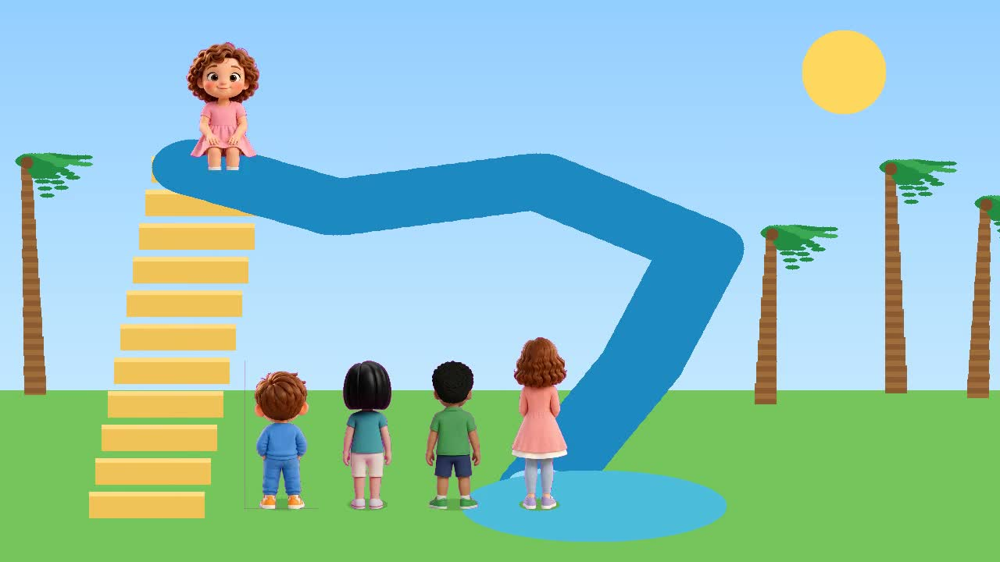

# Sprite Stage

**One-shot agent skill for original 2D cartoons.**

Drop this repo into an agent. The agent runs one command. Character sheets and a reference video come out as a finished sprite film, with a different voice for each person.

[](LICENSE)
Forks are welcome.



Sample film: [`renders/long-slide.mp4`](renders/long-slide.mp4) (2 min 16 sec). Ayzel, Moiz, Lina, Rafi, and Mama climb and slide one at a time.

## One-shot setup

From the repo root, the agent runs:

```bash
bash setup.sh
```

That installs ffmpeg if needed, creates a Python 3.11–3.13 virtualenv, installs PyTorch, OpenVoice, and MeloTTS, and downloads the public voice checkpoints. When it prints `Sprite Stage is ready`, setup is done. Run it again any time. It skips work that is already finished.

Replay the sample:

```bash
python3 render.py
```

Agents should follow [`SKILL.md`](SKILL.md) and [`AGENTS.md`](AGENTS.md). Do not commit API keys. This repo has none.

A 1-minute film on the included cast is roughly **$0.40–$3** of agent tokens. New sprites from a **free image tool add $0**. The same sheets on the paid Gemini image API add about **$1.50**. Full table: [`COSTS.md`](COSTS.md). Sample prompts: [`examples/prompts.md`](examples/prompts.md).

## Make your own

1. Add a full-body reference image per character in [`characters/`](characters/).
2. Ask the agent for sprite sheets. Free tools use the sample prompts in [`examples/prompts.md`](examples/prompts.md). Gemini is optional and only if `GEMINI_API_KEY` is already set. The key is never stored here.
3. Hand the agent a reference video. It keeps the premise and writes an original script. Names, logos, lyrics, and the source's spoken lines stay out of the prompts and off the screen.
4. The agent renders a new film and mixes voices so each line lasts as long as the mouth is open.

## What is in the box

- `characters/` — reference sheets for the whole cast
- `sprites/` — walk, front, back, talking, sitting, and action sheets, plus magenta pose guides
- `renders/long-slide.mp4` — the sample, picture and voices together
- `render.py` — the film. One climber, one rider, palms, smooth per-frame motion
- `voices.py` — British OpenVoice lines, one tone per character

## Spread the word

Guest drafts for Dev.to, Show HN, Reddit, and newsletters are in [`articles/`](articles/). The map of where each one belongs is [`articles/WHERE-TO-POST.md`](articles/WHERE-TO-POST.md).

## Credits

This project stands on tools you can fork:

- [OpenVoice](https://github.com/myshell-ai/OpenVoice) by MyShell, MIT. Tone color for each character.
- [MeloTTS](https://github.com/myshell-ai/MeloTTS) by MyShell, MIT. The spoken words.
- [OpenVoice V2 checkpoints](https://huggingface.co/myshell-ai/OpenVoiceV2) on Hugging Face.
- [PyTorch](https://pytorch.org/) for the voice models.
- [ffmpeg](https://ffmpeg.org/) for sprite keys, frames, and the soundtrack mix.

The picture pipeline is original. Sprite sheets are generated from the reference images in `characters/`, cut out with a strict magenta key so pink clothes stay intact.

The sample story takes its premise from a public long-slide video, [youtube.com/watch?v=9qShcQMq1cA](https://www.youtube.com/watch?v=9qShcQMq1cA). The script, names, clothes, and pictures here are original. This project is not affiliated with that video or its rightsholders.

## License

MIT. Fork it, recast it, and ship your own films. See [LICENSE](LICENSE).
OpenVoice and MeloTTS keep their own MIT notices when `setup.sh` clones them.
